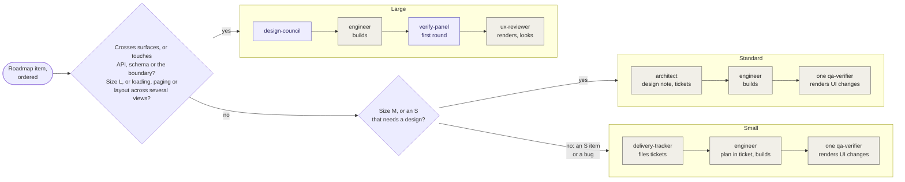
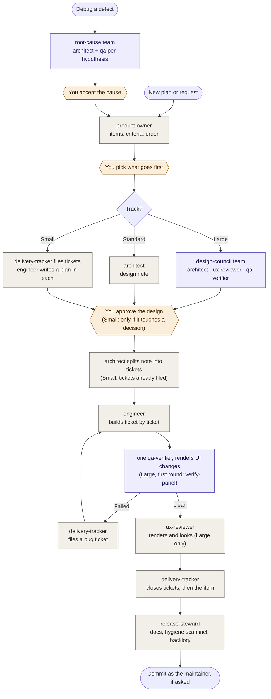
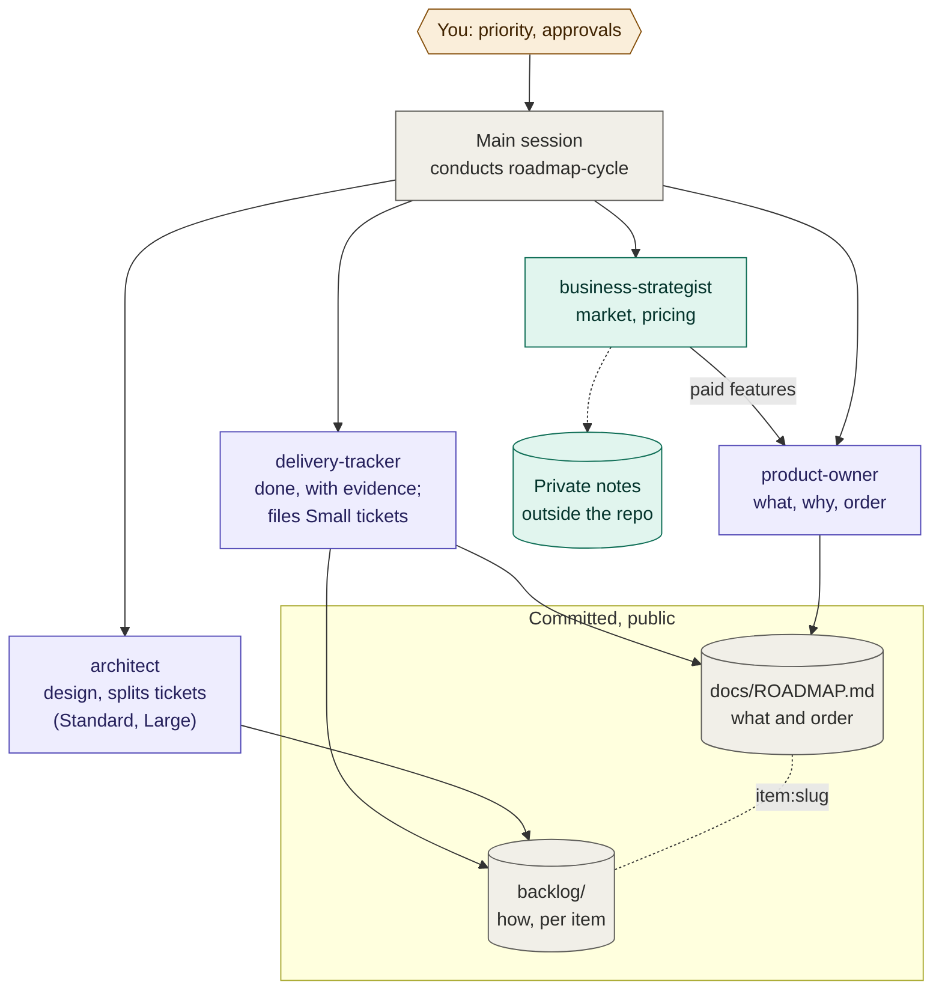
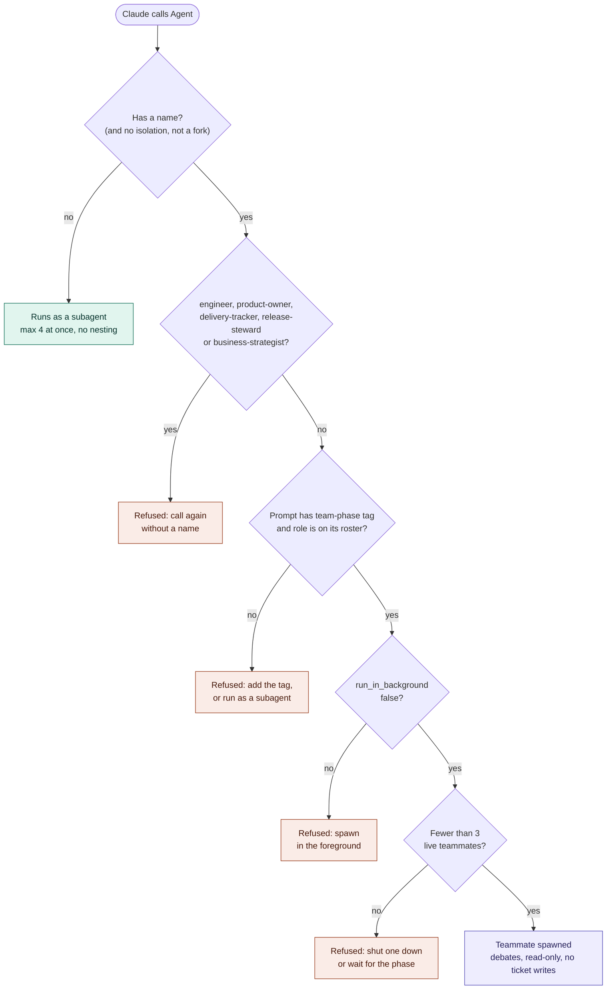
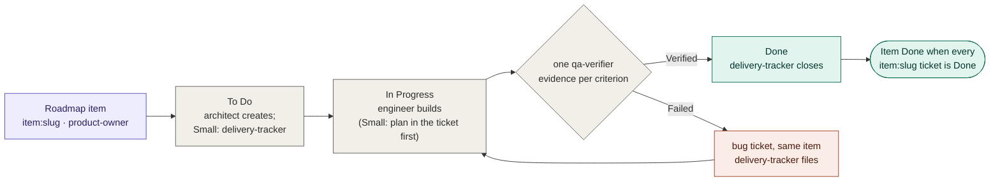

# The agent team

Eight Claude Code subagents, defined in `.claude/agents/`, that work the backlog in
`docs/ROADMAP.md`. The playbook that runs them in order is the `roadmap-cycle` skill
(`.claude/skills/roadmap-cycle/SKILL.md`).

Every role starts from `AGENTS.md`, the index, and reads the `docs/decisions/` files for the
modules it touches. **What** is next and in what order lives only in `ROADMAP.md`;
the state of the project lives only in `docs/STATUS.md` (it moved there from `AGENTS.md` → "Where
we are" in phase G; the phase table stayed in "Where we are"). The one addition is `backlog/` —
tickets that are the **how** under each roadmap item, never a second list of what (see
[Tickets](#tickets)).

| Role | Name (handle) | Owns | Writes | Asks for |
|---|---|---|---|---|
| `product-owner` | Steve Jobs (`steve`) | What and why: items, priority, acceptance criteria, what is *not* being done | `docs/ROADMAP.md` (read-only on tickets) | Decisions only the human can make |
| `architect` | Charles (`charles`) | Structure: modules, twins, golden files, model ↔ web UI mirrors, hot path, security boundary | design notes; tickets split from them; the decision files in `docs/decisions/` | Confirmation before any public-API, schema or boundary change |
| `engineer` | Bob the Builder (`bob`) | Building one designed item, with tests | code and tests; ticket status up to In Progress | A design note before starting |
| `qa-verifier` | Doug the Doomsayer (`doug`) | Evidence: each criterion Verified / Not verified / Failed, guards proven both ways | nothing (read-only) | — |
| `ux-reviewer` | Simon Cowell (`simon`) | Usability of the overlay, the web UI and `INTEGRATION.md`, judged by looking | nothing (read-only) | — |
| `delivery-tracker` | Sherlock Holmes (`sherlock`) | What is actually done | roadmap item state; closing tickets and filing bug tickets; `docs/STATUS.md` and the phase table in `AGENTS.md` | QA evidence before marking anything done |
| `release-steward` | Heimdall (`heimdall`) | What consumers and the public see; release readiness; public-repo hygiene | `INTEGRATION.md`, `DAEMON.md`, `ACCESS.md`, `README.md` | The private term list for the hygiene scan |
| `business-strategist` | Bill Gates (`bill`) | Whether and how the tool makes money: market, competitors, free vs paid, pricing, cheapest demand test | **nothing in this repo** — commercial work stays private | The goal (side income, company, leads), time available; the `architect` for anything needing auth |

## How the definitions are tuned

Each file's frontmatter carries more than a prompt, and each choice has a reason:

- **`AGENTS.md` is never re-read.** `CLAUDE.md` is a symlink to it and Claude Code loads it into
  every subagent, so "read AGENTS.md first" made each role pay for it twice — ~126 KB, before
  phase G made it an index under 15 KB. The prompts point at sections already in context, and name
  the `docs/decisions/` files to Read, because those are not. Each module's `AGENTS.md` imports its
  decision files with `@`. QA's probe showed a subagent gets a module's guide, its parents' guides
  and their imports when it Reads a file there, and not through Bash; whether one that never Reads
  gets them is unverified (`docs/STATUS.md`), so no prompt relies on it.
- **`effort: high` on `architect` and `qa-verifier`** — the two roles whose misses ship.
  **`model: sonnet` on `delivery-tracker`**, which reconciles text against evidence it is handed.
  Everything else inherits the session's model.
- **User-scope `memory` on `release-steward` and `business-strategist`** — the two roles that hold
  knowledge which must never enter this public repository (the private term list; pricing and
  strategy). User scope stores it under `~/.claude/agent-memory/`, outside the repo. In a cloud
  session that directory is discarded with the container, so it persists only on a local machine.
- **`business-strategist` runs with `omitClaudeMd`** and a `PreToolUse` hook,
  `.claude/hooks/block-repo-writes.js`, that refuses any Write or Edit inside the repository —
  memory switches those tools on, so its confidentiality rule needed teeth. Bash writes are outside
  what a hook on those tools can see.
- **`qa-verifier` never restores with `git checkout`.** It runs before the engineer's work is
  committed, so that would revert the very change under test.
- Project-scope memory was considered and left off: it would be a second, unreviewed copy of what
  `AGENTS.md` and `ROADMAP.md` already hold, in a public repository.

## Tracks — the process scales to the item

Each role call costs a full context window, and three reviewers reading one diff mostly duplicate
each other. So before an item is built, the conductor picks the lightest track that fits and says
which. The full rule is in the skill, under "Tracks"; this table is its summary.

| Track | When | Design | Verify |
|---|---|---|---|
| **Small** | An S item or a bug, on one surface | The engineer writes a short plan into the ticket; the delivery-tracker files the tickets | One QA |
| **Standard** | An M item, or an S item that has to be designed | Architect design note and tickets | One QA |
| **Large** | An L item, or one that crosses surfaces, touches API, schema or the boundary, or changes loading, paging or layout across views | design-council | verify-panel for the first round, plus UX |

How the conductor picks a track, and who works on each one. Purple is a team phase, gray is a
single role:

Every fix round, on any track, is re-checked by one `qa-verifier`, never the engineer. A Small
plan that turns out to touch a recorded decision stops for you before it moves up to Standard.

On every track:
- A fix round is re-checked by one QA: the round's own, resumed, or a fresh one.
- QA renders any UI change, live and in an export, at the widths the criteria name.
- The architect reviews a diff only when code is restructured or a decision file is rewritten.
- An item does not grow after its design gate: a new defect becomes its own roadmap item unless it
  fails this item's criteria or is a regression this item introduced.

The reason is `item:web-transactions-paged` (2026-10-19), which ran the full panel twice:
- QA found or confirmed every blocker.
- The architect's place in the verify panel added nothing QA did not also find.
- The two UI blockers showed only in a rendered page. That argues for QA rendering the page, not
  for a separate reviewer.

## Flow of one item

Gray is a subagent working alone, purple is a team phase where teammates argue, amber is you.

Who owns which record — the strategist sits off the delivery line, and its work never enters the
repository:

Think of it as a newsroom: the product owner is the editor choosing stories, the architect is the
style-and-standards desk, the engineer is the reporter, QA is the fact-checker, the UX reviewer is
the reader panel, the tracker keeps the published record honest, the release steward decides
what goes to print, and the business strategist sells the ads — and keeps the rate card off the
public noticeboard.

## Agent teams

`CLAUDE_CODE_EXPERIMENTAL_AGENT_TEAMS` is on in `.claude/settings.json`. The roles above still run as
subagents; three of them can also run as **teammates** — full sessions that message each other —
in three phases of `roadmap-cycle` where the point is for reviewers to argue:

| Phase | Replaces | Roster | Why a team and not subagents |
|---|---|---|---|
| design-council | Mode B step 1, on the Large track only | `architect`, `ux-reviewer`, `qa-verifier` | QA writes how each criterion will be proven *before* the build, and UX objects before the code exists |
| verify-panel | Mode B steps 5–6, the first round of a Large item only | `qa-verifier`, `architect`, `ux-reviewer` (UI items) | Each tries to break the others' "Verified" — the thing parallel subagents cannot do |
| root-cause | new Mode E, `debug <defect>` | `architect`, `qa-verifier` × hypotheses | Competing hypotheses, each trying to disprove the rest; avoids anchoring on the first plausible story |

What `team-guard.js` decides each time Claude calls the Agent tool:

The limits are hooks, not prose, for the same reason as `block-repo-writes.js`:

- **`.claude/hooks/team-guard.js`** (PreToolUse on `Agent`). With teams on, any *named* Agent call
  launches a teammate, and Claude names subagents on its own — so an ordinary step could quietly
  become a team. The guard allows a teammate only for a declared phase (`[team-phase: …]` in the
  prompt), only from that phase's roster, and at most `INSPECTOR_TEAM_MAX` (3) live at once.
- **How the hooks know who is a teammate, and how many are live.** A teammate's hook payload is the
  same as a subagent's (the lead's session id, its own agent id and type, no name), and the team
  directory `~/.claude/teams/<session>/` holds only `inboxes/` — no member list. The first version
  of these hooks read a `config.json` that does not exist, so the read-only rule, the ticket rule
  for teammates and the cap all passed everything; a teammate's Edit went through in a probe on
  2026-10-18. `lib/teammate.js` now reads the agent's `.meta.json` beside its transcript, which
  carries the spawn `name` (a named agent is a teammate), and **`.claude/hooks/team-registry.js`**
  (SubagentStart, SubagentStop, PostToolUse on Agent) keeps a per-session registry of live
  teammates under the OS temp dir that `team-guard.js` counts, under a lock so members spawned in
  one message are counted together. Entries expire (10 minutes pending, 3 hours live) so a crash
  cannot hold a slot. Proven live: a teammate's Edit refused, a fourth spawn refused at the cap,
  the registry empty once the phase ended.
- **Never teammates:** `engineer` — teammates share one working tree with no worktree isolation;
  `business-strategist` and `release-steward` — a teammate receives a definition's `tools`, `model`,
  `disallowedTools`, `effort` and body, but **not** its `hooks`, `memory` or `omitClaudeMd`, so the
  write block and the private term list would silently vanish; `product-owner` and
  `delivery-tracker` — they own human gates and state that exists only after a phase.
- **A teammate is spawned in the foreground, and the guard refuses one that is not.** The Agent
  tool backgrounds by default, and a backgrounded named agent is not an in-process teammate. Measured
  on 2026-10-18 with the same `qa-verifier` and `architect` definitions: in the foreground each had
  `SendMessage`, `TaskList`, `TaskGet` and `TaskUpdate`, read the lead's task list, claimed a task,
  and exchanged messages within its turn; in the background each had `SendMessage` alone, no task
  list, and a message reached it only by resuming it after its turn ended. Every team phase in
  phase F had been spawned in the background, which is why its members reported missing tools and
  the lead relayed their findings. Spawn all members of a phase in **one message** with
  `run_in_background: false`, so they run at once and the lead waits for the phase. The three
  roster roles also list `SendMessage` and the Task tools in `tools`; the docs say an in-process
  teammate gets them injected anyway, so the list is belt and braces, not the fix. Writes stay
  refused by the two hooks below whatever `tools` says.
- **`.claude/hooks/team-read-only.js`** (PreToolUse on Write/Edit). A teammate cannot write files;
  it sends proposed text to the lead, who routes it to the owning role afterwards. Bash writes are
  outside what the hook sees, as with the strategist's.
- **`CLAUDE_CODE_MAX_SUBAGENT_SPAWN_DEPTH=1`** — subagents cannot spawn subagents, which is what
  the conductor rule already asks; **`CLAUDE_CODE_MAX_CONCURRENT_SUBAGENTS=4`** (default 20).
- **`CLAUDE_CODE_ENABLE_TODO_TOOLS=1`** — current models get the Task tools only on opt-in, and
  without them teammates coordinate by message alone instead of through the shared task list.
- **Snapshots: reviewers copy revisions with `scripts/qa-snapshot.sh`, never with a hand-written
  loop.** `P=$(scripts/qa-snapshot.sh head=HEAD base=<rev>)` puts each revision in a fresh
  `mktemp -d` directory and deletes nothing. Bypass mode skips permission rules but not Claude
  Code's own check on a Bash command it cannot prove safe, and the reviewers' old pattern (`cd`
  into the repository, then `rm -rf $D/$n` in a loop over revisions, then `git init` in a
  subshell) tripped it three times on 2026-10-18 and 2026-10-19. The approval card waits for the
  human with no timeout: one `qa-verifier` teammate sat on it for 3 h 54 min while the rest of the
  panel had finished. Also never chain `cd <repo>` with a deletion in one command.

What a team costs: every teammate loads the project context — `AGENTS.md` and the decision files
its role reads — into its own context window, so a three-member phase pays for it three more times. Teams need an interactive session — under `claude -p` or the
Agent SDK, named calls run as ordinary subagents. `/resume` does not bring in-process teammates back;
after a resume, tell the lead to spawn fresh ones. To switch teams off, set the variable to `0` in
`.claude/settings.local.json`; the guards stand down by themselves.

## Tickets

`backlog/` is a [Backlog.md](https://github.com/MrLesk/Backlog.md) project: one markdown file per
ticket, IDs `KIN-N`, statuses To Do / In Progress / Done. It is committed, so tickets travel with
the branch — and are public.

The rules that keep it from becoming a second backlog:

- **Every ticket hangs under a roadmap item**, labelled `item:<slug>` with the slug the item names
  under its heading. A defect found outside any item goes to the `product-owner` first.
- **Pace rules from the signals item (2026-10-19).** The conductor's list is in the skill under
  "Pace": decide a round's scope before spawning its engineer and give a large ticket its own round;
  a fresh engineer per item; size the review to the item by its track (see [Tracks](#tracks--the-process-scales-to-the-item); one QA for every fix round); one owner
  per finding; a close verdict that blocks only on this item's criteria and regressions; heuristics
  documented as heuristics; `scripts/env-check.sh` before the first engineer, with no agent
  downloading a toolchain; a reviewer's harness that proves an unguarded criterion promoted to
  `scripts/lib/` in the same item; and a cost line (calls by role, tokens, wall time, track,
  rounds) recorded when the item closes. The engineer runs fast checks per ticket and the full set, Chrome
  included, once per round (`.claude/agents/engineer.md`); QA's bar for documentation is a false
  claim, not one more missed case (`.claude/agents/qa-verifier.md`).
- **A bug ticket stays inside its item.** Before a fix round is built, the conductor reads each
  new bug ticket's criteria for scope (the `architect` does it on the Large track). A criterion that needs another roadmap item's work, or a
  defect whose own text says it predates the diff, goes to the `product-owner` instead of into the
  round. In the signals item, one criterion ("the path's '0 of N' uses an uncapped N") pulled in
  the next item's whole-session paging, and it and a pre-existing layout fix caused all six
  blocking tickets of the two later rounds (KIN-37 to KIN-42).
- **No priority on tickets.** Order lives in `ROADMAP.md`; dependencies between tickets use `--dep`.
- **Tickets come after the design gate**, split by the `architect` from the agreed note, so a
  rejected design leaves no orphans. On the Small track there is no note: the `delivery-tracker`
  files the tickets from the roadmap item's criteria, and the `engineer` writes its plan into each.
- **Only the `delivery-tracker` closes**, ticking only criteria the `qa-verifier` showed Verified,
  with the evidence in `--final-summary`. A roadmap item is Done when all its tickets are.
- **Definition of Done** (in `backlog/config.yml`, added to every ticket): QA evidence per
  criterion, every guard proven both ways, no client, employer or product name anywhere. A ticket
  that touches `web/` is also done only when `scripts/measure-web-ui.js --base <round's base>`
  shows nothing moved that the ticket did not mean to move, and nothing on head failed that passed on base.
- **Public:** the `release-steward`'s hygiene scan covers `backlog/`. Commercial work never
  becomes a ticket.

Who may change tickets — enforced by `.claude/hooks/backlog-guard.js` on Bash and on direct file
edits:

| Role | Tickets |
|---|---|
| `architect` | create and edit; never Done, archive or delete |
| `engineer` | move to In Progress, add notes (its plan, on the Small track); never Done, archive or delete |
| `delivery-tracker`, main session | anything, including Done and bug tickets |
| `product-owner`, `qa-verifier`, `ux-reviewer`, `release-steward`, `business-strategist`, every teammate | read-only — they report ticket text, the tracker files it |

Ticket files change only through the CLI, except for the `delivery-tracker` and the main session,
so an Edit cannot sidestep the rules. The hook reads command text: it stops honest mistakes, not
an agent set on writing a file some other way.

**Setup on a new machine:** `npm i -g backlog.md` (or `brew install backlog-md`). Then
`backlog board` in the terminal, or `backlog browser` for the web board on 127.0.0.1:6420. The
`backlog` folder's own `decisions/` and `docs/` are unused — decisions live in `docs/decisions/`.

## Using it

- **Hand over a plan:** "take this plan" with the plan pasted or a path → `roadmap-cycle` Mode A.
  It stops after intake and asks what goes first.
- **Build an item:** "build *<roadmap item name>*" → Mode B.
- **Debug a defect:** "debug *<defect>*" → Mode E, the root-cause team phase.
- **Status:** "where are we" → Mode C, roadmap and board together. Or look yourself:
  `backlog board`.
- **Money:** "use the business-strategist" — it interviews you first, and keeps its output out of
  the repository.
- Any single role can be called directly, e.g. "use the ux-reviewer on the web UI".
